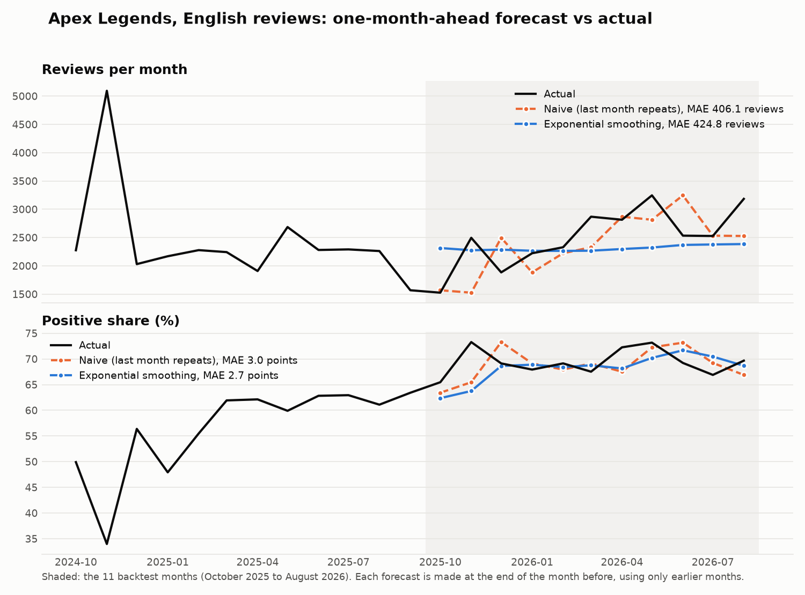

# steam-sql: a Steam review study, reproduced in SQL

A small SQL project that rebuilds the figures of my published Steam review study using only SQL, in DuckDB.

The study asks why Apex Legends reviews are far less positive in some languages than in English. It found that most of the Simplified script gap was a single review-bombing month. The study and its dashboards are already published; this repo reproduces its numbers from the data with SQL, so every figure can be traced to a query.

A second part forecasts monthly review volume and positive share and tests the forecasts against what actually happened (a rolling backtest). It is below, under "Forecasting".

- Study page: https://jozxo.github.io/player-sentiment/ (code: https://github.com/JozXO/player-sentiment)
- Dashboards (Tableau Public and Power BI): https://github.com/JozXO/steam-dashboards

## What is in here

| Path | What it is |
|---|---|
| `queries/` | 15 numbered SQL files, one question each, with plain-English comments |
| `run_all.py` | Runs every query and prints a check table: expected number, SQL result, match yes/no |
| `forecast.py` | Exponential smoothing and its rolling backtest, in plain Python (the other models are SQL) |
| `forecast_checks.py` | Independent pandas recomputation of the whole forecasting part, used by the check table |
| `make_chart.py` | Draws `results/forecast_vs_actual_english.png` |
| `results/` | Forecasting outputs: monthly series, every backtest forecast, scores, the chart |
| `load_data.py` | Builds `steam.duckdb` from the CSVs in `data/` and checks row counts |
| `data/` | The data the SQL needs (see "Data" below) |
| `make_data.py` | How `data/` was made from the original study files (only needed by the author) |
| `LEARN.md` | Study guide: what each query does, line by line, plus practice exercises |

## What the queries show

SQL skills used: `GROUP BY` and `HAVING`, `JOIN` (inner, left, self-join), CTEs, conditional aggregation (`FILTER`, `CASE`), window functions (`LAG`, `RANK`, `ROW_NUMBER`, running and trailing frames, named windows), medians and standard deviations.

| Query | Question |
|---|---|
| 01 | How many reviews, and what share is positive, per language? |
| 02 | How many reviews survive the shared time window and the review-bomb removal? |
| 03 | Which language-months are review bombs? (a stated rule: volume over 2 times the median and positive share 15 points under it) |
| 04 | What is the Apex gap between English and Traditional script reviews? |
| 05 | How big is each language's gap to English, with and without the bomb months? |
| 06 | Do the cleaned reviews and Steam's lifetime totals agree? (join to the baseline table) |
| 07 | How does monthly volume compare with its trailing average? |
| 08 | Which months moved most? (`LAG` and `RANK`) |
| 09 | Control chart: which months have a negative share outside limits built from earlier months? |
| 10 | Which of the 14 games has the widest Traditional script gap? |
| 11 | Monthly review volume and positive share per language, on the study's clean sample (the forecasting series) |
| 12 | Naive, seasonal naive and 3-month moving average forecasts, one and three months ahead |
| 13 | Backtest scores: MAE and MAPE per model, and how each compares with the naive baseline |
| 14 | In how many of the 5 languages does each model beat the naive baseline? |
| 15 | Plan vs actual: the one-month-ahead forecast against what happened, last 6 months |

## Forecasting: does a smarter model beat "last month repeats"?

Queries 11 to 15 forecast two monthly series per language, **review volume** and **positive share**, and test the forecasts the way a plan is tested: stand at the end of each past month, forecast the next month (and the month three ahead) using only earlier months, then compare with what happened. The first three models are SQL; exponential smoothing is a short Python function in `forecast.py`, because it needs a loop.

**Data.** The study's clean sample: October 2024 to August 2026, 23 months for each of the five languages. July to September 2024 (the review bomb) is excluded exactly as in Q2, nothing earlier is used, and the last month in the data is dropped because the data stops on 21 September 2026 and a part-month would look like a collapse. November 2024 was also unusual in English (Q3 flags it, but the study does not remove it), and it stays in, as in the study.

**Models**, with the rules fixed before any score was looked at:

| Model | Forecast |
|---|---|
| Naive (the baseline) | last month repeats |
| Seasonal naive | the same month one year earlier |
| 3-month average | the average of the last 3 months |
| Exponential smoothing | a weighted average of all earlier months, newest weighted most; the weight (alpha, tried from 0.05 to 1.00) is chosen on the earlier months only |

**Backtest.** The first forecast uses 12 months of history; the window then grows one month at a time. That gives 11 target months at one month ahead (October 2025 to August 2026) and 9 at three months ahead, the same for every model. **MAE** is the average absolute miss (reviews for volume, percentage points for share); **MAPE** is the average miss as a percent of the actual value (shown for volume only).

One month ahead, volume, MAE in reviews (MAPE in brackets):

| Language | Naive | Seasonal naive | 3-month average | Exp. smoothing | Lowest MAE |
|---|---|---|---|---|---|
| English | 406 (16.1%) | 646 (25.9%) | 406 (16.3%) | 425 (17.4%) | 3-month average |
| Simplified script | 695 (31.7%) | 605 (35.9%) | 621 (31.6%) | 542 (25.4%) | exp. smoothing |
| Traditional script | 67 (34.2%) | 50 (24.6%) | 47 (24.8%) | 40 (20.0%) | exp. smoothing |
| Japanese | 35 (24.5%) | 29 (19.9%) | 26 (19.3%) | 24 (17.5%) | exp. smoothing |
| Korean | 16 (26.7%) | 31 (50.1%) | 17 (26.9%) | 18 (31.7%) | naive |

One month ahead, positive share, MAE in percentage points:

| Language | Naive | Seasonal naive | 3-month average | Exp. smoothing | Lowest MAE |
|---|---|---|---|---|---|
| English | 2.98 | 13.56 | 2.94 | 2.74 | exp. smoothing |
| Simplified script | 5.70 | 21.31 | 4.45 | 6.10 | 3-month average |
| Traditional script | 7.11 | 9.15 | 5.46 | 4.99 | exp. smoothing |
| Japanese | 3.37 | 7.64 | 3.34 | 2.78 | exp. smoothing |
| Korean | 6.68 | 10.29 | 6.88 | 6.41 | exp. smoothing |

Three months ahead is in `results/backtest_scores.csv`. Query 14 counts the languages (of 5) where each model had a smaller MAE than naive:

| Measure | Horizon | 3-month average | Exp. smoothing | Seasonal naive |
|---|---|---|---|---|
| Volume | 1 month | 4 of 5 | 3 of 5 | 3 of 5 |
| Volume | 3 months | 4 of 5 | 4 of 5 | 4 of 5 |
| Positive share | 1 month | 4 of 5 | 4 of 5 | 0 of 5 |
| Positive share | 3 months | 5 of 5 | 5 of 5 | 0 of 5 |

**What this shows, plainly**

- Exponential smoothing did not beat naive everywhere. One month ahead it was worse for English volume (425 against 406 reviews), Korean volume (18 against 16) and Simplified script share (6.10 against 5.70 points). Where it did better, its MAE was lower by 4% to 40%; the unweighted average of the five languages' differences is 15% lower for volume and 10% lower for share.
- In English volume, naive and the 3-month average are tied (406 each). The English plan from exponential smoothing sat close to a flat line (alpha was 0.05, the lowest value tried, in all 11 backtest months), so it missed the rise in reviews from 2025 to 2026: in the table below it was too low in all six months.
- Seasonal naive is the weakest for share (it beat naive in 0 of 5 languages). With only 23 months, the year-ago month is the aftermath of the bomb, when shares were still recovering.
- This is a small test: 11 months per language at one month ahead, no significance test. One or two surprise months can swap two models' places, so read the tables as "smoothing usually helps a little, not always", not as a ranking. I did not change the alpha range after seeing the results, because that would be tuning on the test months.

Plan vs actual for English, the last 6 months (forecast made at the end of the month before; a positive miss means the plan was too low). Volume, in reviews:

| Month | Actual | Naive plan | Exp. smoothing plan | Naive miss | Exp. smoothing miss |
|---|---|---|---|---|---|
| 2026-03 | 2,869 | 2,329 | 2,268 | +540 | +601 |
| 2026-04 | 2,815 | 2,869 | 2,298 | -54 | +517 |
| 2026-05 | 3,246 | 2,815 | 2,324 | +431 | +922 |
| 2026-06 | 2,534 | 3,246 | 2,370 | -712 | +164 |
| 2026-07 | 2,528 | 2,534 | 2,378 | -6 | +150 |
| 2026-08 | 3,184 | 2,528 | 2,386 | +656 | +798 |

Positive share, in percent and points:

| Month | Actual | Naive plan | Exp. smoothing plan | Naive miss | Exp. smoothing miss |
|---|---|---|---|---|---|
| 2026-03 | 67.5 | 69.1 | 68.8 | -1.6 | -1.3 |
| 2026-04 | 72.3 | 67.5 | 68.1 | +4.7 | +4.1 |
| 2026-05 | 73.2 | 72.3 | 70.2 | +0.9 | +3.0 |
| 2026-06 | 69.2 | 73.2 | 71.7 | -3.9 | -2.5 |
| 2026-07 | 66.9 | 69.2 | 70.5 | -2.3 | -3.6 |
| 2026-08 | 69.7 | 66.9 | 68.7 | +2.8 | +1.0 |



This is a backtest on past months. It makes no claim about the months after August 2026.

## How to run it

```bash
pip install duckdb pandas
python run_all.py            # check table only
python run_all.py --show     # also prints every query result
pip install matplotlib
python make_chart.py         # redraws the chart in results/ (run run_all.py first)
```

Python 3.10 or later. The script rebuilds `steam.duckdb` from `data/` each time, so there is nothing else to set up. You can also open `steam.duckdb` in the DuckDB command line and paste any file from `queries/`.

## Check table

`run_all.py` compares each SQL result with an expected number. For Q1 to Q10 the expected number is the one I published (from the write-up, the dashboard data tables, or the study's own output files). The forecasting part has no published numbers, so for Q11 to Q15 (and the exponential smoothing rows) the expected number comes from an independent recomputation in pandas (`forecast_checks.py`) that reads the raw reviews file and does not use the SQL. Latest run: all 40 match (23 against published numbers, 17 against pandas).

| Query | Check                                                                            | Expected                          | SQL result                        | Match |
|-------|----------------------------------------------------------------------------------|-----------------------------------|-----------------------------------|-------|
| Q1    | Reviews collected                                                                | 218,380                           | 218,380                           | yes   |
| Q2    | Reviews in the shared window (dashboard data_quality)                            | 169,612                           | 169,612                           | yes   |
| Q2    | Reviews removed as review bomb (dashboard data_quality)                          | 54,873                            | 54,873                            | yes   |
| Q2    | Reviews after window and review-bomb removal                                     | 114,739                           | 114,739                           | yes   |
| Q2    | Percent of all reviews removed                                                   | 47.5                              | 47.5                              | yes   |
| Q3    | Review-bomb table (apex_review_bombs.csv): every row and column identical        | 12 rows                           | 12 rows                           | yes   |
| Q3    | Simplified script, July 2024: times normal volume                                | 14.9                              | 14.9                              | yes   |
| Q3    | Simplified script, July 2024: positive %                                         | 8.8                               | 8.8                               | yes   |
| Q4    | Apex English positive %                                                          | 76.6                              | 76.6                              | yes   |
| Q4    | Apex Traditional script positive %                                               | 40.1                              | 40.1                              | yes   |
| Q4    | Apex gap, English minus Traditional script (points)                              | 36.5                              | 36.5                              | yes   |
| Q4    | English lifetime reviews                                                         | 450,786                           | 450,786                           | yes   |
| Q5    | Simplified script gap with bomb (points)                                         | 20.8                              | 20.8                              | yes   |
| Q5    | Simplified script gap without bomb (points)                                      | 4.1                               | 4.1                               | yes   |
| Q5    | japanese: gap with / without bomb (apex_gap_bomb_effect.csv)                     | 16.7 / 18.1                       | 16.7 / 18.1                       | yes   |
| Q5    | koreana: gap with / without bomb (apex_gap_bomb_effect.csv)                      | 3.3 / -0.9                        | 3.3 / -0.9                        | yes   |
| Q5    | schinese: gap with / without bomb (apex_gap_bomb_effect.csv)                     | 20.8 / 4.1                        | 20.8 / 4.1                        | yes   |
| Q5    | tchinese: gap with / without bomb (apex_gap_bomb_effect.csv)                     | 27.9 / 23.1                       | 27.9 / 23.1                       | yes   |
| Q6    | Language values in the baseline (6 languages + 'all')                            | 7                                 | 7                                 | yes   |
| Q10   | Games in the baseline                                                            | 14                                | 14                                | yes   |
| Q10   | Apex has the widest Traditional script gap of 14 games (rank)                    | 1                                 | 1                                 | yes   |
| Q10   | Traditional script gap, all 14 games (gaps_by_game.csv)                          | 14 of 14                          | 14 of 14                          | yes   |
| Q9    | Control chart flags Korean July and August 2024 (both are in the bomb table)     | flagged                           | flagged                           | yes   |
| Q11   | Monthly series rows (5 languages x 23 months)                                    | 115                               | 115                               | yes   |
| Q11   | Series values (reviews, positive %) identical to pandas, all rows                | 115 of 115                        | 115 of 115                        | yes   |
| Q11   | Series runs October 2024 to August 2026, no July to September 2024               | 2024-10 to 2026-08, 0 bomb months | 2024-10 to 2026-08, 0 bomb months | yes   |
| Q12   | Forecast rows: 5 languages x 2 measures x (11 + 9) target months                 | 200                               | 200                               | yes   |
| Q12   | Naive forecasts identical to pandas, all rows                                    | 200 of 200                        | 200 of 200                        | yes   |
| Q12   | Seasonal naive forecasts identical to pandas, all rows                           | 200 of 200                        | 200 of 200                        | yes   |
| Q12   | 3-month moving average forecasts identical to pandas, all rows                   | 200 of 200                        | 200 of 200                        | yes   |
| SES   | SES forecasts and chosen alpha identical to pandas (.ewm), all rows              | 200 of 200                        | 200 of 200                        | yes   |
| SES   | SES level, loop vs weighted-average formula (English volume, alpha 0.3)          | 2,794.3                           | 2,794.3                           | yes   |
| SES   | SES with alpha = 1 gives the last value (= naive)                                | 3,184.0                           | 3,184.0                           | yes   |
| Q13   | Backtest scores (MAE, MAPE, vs naive), 80 rows, identical to pandas              | 80 of 80                          | 80 of 80                          | yes   |
| Q13   | English volume MAE, 1 month ahead, naive (reviews)                               | 406.1                             | 406.1                             | yes   |
| Q13   | English volume MAE, 1 month ahead, ses (reviews)                                 | 424.8                             | 424.8                             | yes   |
| Q13   | English positive share MAE, 1 month ahead, naive (points)                        | 3.0                               | 3.0                               | yes   |
| Q13   | English positive share MAE, 1 month ahead, ses (points)                          | 2.7                               | 2.7                               | yes   |
| Q14   | Languages beating naive, per measure, horizon and model (12 rows)                | 12 of 12                          | 12 of 12                          | yes   |
| Q15   | Plan vs actual, last 6 months (60 rows): actual and SES plan identical to pandas | 60 of 60                          | 60 of 60                          | yes   |

The full output, one row per check, is written to `check_table.md` every run.

## Notes on the data and the method

- **Data.** The reviews are 218,380 Apex Legends reviews from the public Steam review API in five languages. `data/reviews_apex.csv.gz` holds five columns (id, language, positive or negative, timestamp, hours played) and leaves out the review text, which the SQL does not need. `data/baseline_summaries.csv` has Steam's lifetime totals for 14 games. `data/published/` holds the study's own output files, used only to check the SQL. `make_data.py` shows how they were made. Times are UTC.
- **The bomb period.** The study removes July to September 2024 as a block. As in the study code, the end of the period is 30 September at 00:00, so 182 reviews from later on 30 September stay in. Removing all of September would give 114,557 clean reviews instead of 114,739 and leave every headline gap unchanged to one decimal.
- **Rounding.** As in the study, positive shares are rounded to one decimal before they are subtracted to get a gap.
- **Forecasting limits.** The series has 23 months per language, so the backtest has 9 to 11 scored months and no significance test; the exponential smoothing weight is picked from a grid of 20 values using only earlier months. See the Forecasting section above for what the results do and do not show.
- **Q9 limit.** English data starts two months before the July 2024 spike and Simplified script data starts at it, so a control chart built from earlier months cannot judge that spike for those two languages. `LEARN.md` explains this.

## How this was built

The queries were drafted with Claude Code, an AI coding assistant, as a coding partner. I then ran them against my own data and checked every result against the figures I had already published. `LEARN.md` explains each query in plain words so that I can explain and rewrite it myself.
